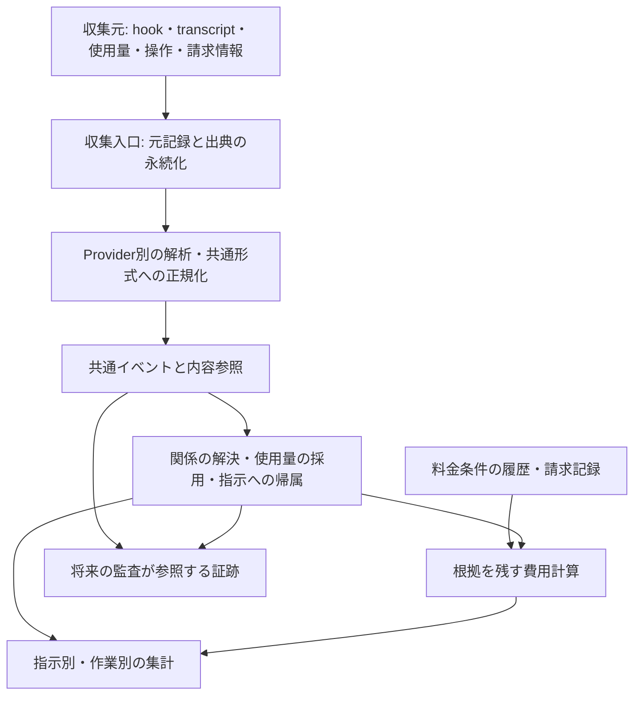
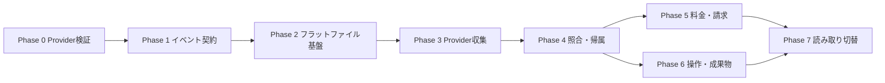

# 収集設計案: 指示別のトークン・費用分析と操作監査

本ドキュメントは**検討段階の提案**であり、[docs/design.md](design.md)が記述する現行実装ではない。1節で収集要件を定め、2節以降はその要件に基づいて現行仕様からの変更を含む設計案を示す。実装コード・Provider設定の変更は本資料の更新に含めない。

## 0. 目的

**どのような指示（プロンプト）を出したときに、どれくらいのトークンが使われ、お金がかかるかを分析できるようにすること**を主目的とする。補助目的として、危険なコマンドや外部送信等が実行されなかったかを事後監査できるようにする。

現状のmaatplugは指示テキストとターン単位の使用量を記録し、読み取り時に料金表から費用を計算する。今回の提案では、この集計を支える情報を、指示、モデル呼び出し、入力コンテキスト、ツール操作、実行環境、料金条件、実支出まで拡張する。指示別・作業別の合計と、その数字を構成する記録の両方を追えるようにする。

分析と監査は同じ観測記録・内容参照・関係を利用する。収集・保存・関連付けを今回の検討範囲とし、詳細な分析UI、AI監査の実行、事前ブロックは後続機能とする。Claude Code・Codexの双方を対象に、現在の取得可否を収集要件の制約にせず検討する。

---

## 1. 収集する情報一覧（収集要件）

今回は、**指示ごとのトークン使用量・費用分析を主目的、危険な操作等の事後監査を補助目的として、何を収集すべきかを定義する**。現時点の収集可否、Providerごとの対応状況、実装コストは、収集対象を選ぶ際の制約にしない。以下の優先度は分析上の重要度であり、実装順序の確定ではない。

指示単位の合計だけでなく、その合計を構成するモデル呼び出し・入力・操作・料金条件まで追えることを目指す。同じ指示でも履歴や実行条件によって費用は変わるため、指示内容だけが費用の原因だったと断定しない。収集要件は本節を基準とし、2節以降で共通データモデル、収集・保存、料金、監査証跡、切り替え・検証の設計案を示す。監査判定の実行そのものは引き続き対象外とする。

### 1.1 主目的: 指示・トークン・費用の分析用情報

既存項目も含め、分析に必要な収集対象を示す。新規追加・既存拡張・集計時の導出の区別は、1.4節に記載する。

| 優先度 | 情報 | 粒度 | 記録・保持する内容と用途 |
|---|---|---|---|
| 最優先 | 指示内容・指示間の関係 | 指示ごと | 指示ID、テキスト、送信時刻、添付資料への参照、追加・修正・やり直し元の指示ID。何を依頼したかと、目的達成までの指示の連なりを追う |
| 最優先 | 指示・呼び出し・エージェントの対応 | 作業／セッション／指示／呼び出しごと | 作業全体のID、プロジェクトID、セッションID、指示ID、モデル呼び出しID、ツール呼び出しID、エージェントID、親子関係、委任先への指示。サブエージェントを含めた集計と二重計上防止に使う |
| 最優先 | 使用量の帰属 | 使用量記録ごと | 単独指示への帰属、複数指示の共有分、統合先、帰属不明の区別。配賦する場合は対象・方法・比率・根拠を保持し、実測値と推定配賦を分ける |
| 最優先 | モデル呼び出しごとの使用量 | 呼び出し・試行ごと | 開始・終了時刻、実際のProvider・モデル・モデル版、入力・出力・キャッシュ読取／書込・推論・画像／音声等の使用量、成否。途中のモデル変更や失敗した試行も含める |
| 最優先 | 使用量の定義と元データ | 使用量記録ごと | Providerが返した元の使用量フィールドと正規化値、単位、呼び出し単位か累積値か、入力とキャッシュ・出力と推論等の包含関係、計測区間、集計対象範囲。重複加算やProvider間の解釈違いを防ぐ |
| 最優先 | 入力コンテキストの構成と量 | モデル呼び出し内の入力要素ごと | 今回の指示、会話履歴、システム指示、適用ルール・スキル、ツール定義、参照ファイル、ツール出力、添付画像等の種類・参照先・版・サイズ・トークン数・キャッシュ利用情報。実際に渡された内容への参照と、入力元との対応を残す |
| 最優先 | 料金計算の根拠・履歴 | 料金条件／課金項目／計算ごと | 適用単価と単位、料金表の版・適用期間・取得日時・出典、通貨、課金方式、サービス区分、キャッシュ条件、割引・段階料金等の条件、計算方式の版。当時の条件での費用と現在単価による再計算を区別する |
| 最優先 | 推定費用・実際の支出 | 呼び出し／指示／請求期間ごと | API単価換算額、実請求額、定額契約等の支払情報、請求対象期間・利用明細との対応。外部ツール等の料金は別項目とし、円換算時は為替レート・基準日時・出典、配賦時は方法・根拠を保持する |
| 高 | ツール呼び出しの入出力・経過 | ツール呼び出しごと | ツール名・引数、コマンド文字列、入力・出力内容への参照、stdout／stderr等のサイズ、モデルに渡された量、切り詰め・要約の有無、成否・エラー、開始・終了時刻。どの結果がどのモデル呼び出しへ入力されたかも紐付ける |
| 高 | 再試行・中断・継続 | 試行／状態変化ごと | 再試行元と理由、キャンセル、タイムアウト、自動継続、モデル切り替え、コンテキスト圧縮の発生時刻・対象・前後の量・生成した要約への参照。最終回答に至らなかった処理の使用量も追う |
| 高 | 実行条件 | 設定・状態のスナップショットと変更ごと | 推論設定、出力上限、エージェント／クライアントの版、利用可能ツールと版、ルール・スキルの版、プロジェクトの規模・リビジョン・未コミット変更等の状態。同条件で指示を比較するために使う |
| 高 | 結果・達成状況 | 指示／作業ごと | 最終回答・成果物への参照、完了・失敗・中断、検証結果、ユーザー評価とその出典・時刻、やり直し指示との関係。目的達成までの総費用を比較する |
| 高 | 所要時間と待ち時間 | 指示／呼び出し／操作ごと | 開始・終了時刻、モデル処理・ツール実行・承認待ち・その他の待機区間。全体の経過時間と各処理時間を分け、並列区間を単純加算しない |
| 補足 | 変更量・言語別内訳・変更対象 | 指示／ファイル／言語ごと | 追加・削除行数、変更ファイル数、変更対象パス、言語、生成物等の区分、比較元・比較先、測定方式・言語判定方式。clocの純増減はgit diffの追加・削除量と分けて保持する |
| 補足 | プロジェクト規模 | セッション境界／比較に必要な時点ごと | clocの合計・言語別行数・ファイル数と対象範囲。作業対象の規模による違いを比較する |

モデル呼び出しごとの使用量、指示との対応、入力コンテキスト、料金の根拠を、言語別diffの拡充より優先する。推論については使用量・設定を対象とし、内部思考の全文は収集要件に含めない。

### 1.2 補助目的: 操作の監査用情報

1.1節の指示・ツール呼び出し情報を共用し、操作が実行されたか、何に作用したか、許可範囲に沿っていたかを判断するための情報を加える。シェルコマンドだけでなく、ファイル編集ツール、ブラウザー、MCP・コネクター、外部API等の操作も対象にする。

| 情報 | 粒度 | 記録・保持する内容と用途 |
|---|---|---|
| 操作の状態・実行結果 | 操作／状態変化ごと | 要求、承認待ち、許可、拒否、開始、完了、失敗、中断と各時刻、終了コード、エラー、結果への参照。要求された操作と実行済みの操作を区別する。終了コードだけで副作用の有無を断定しない |
| 実行環境 | 操作ごと | その時点の作業ディレクトリ、OS・シェル、ホスト／コンテナー等の識別子、実行ユーザー、権限、サンドボックス・権限昇格の状態。同じコマンド文字列でも対象や影響が変わる条件を残す |
| 対象と作用 | 操作／対象ごと | 読取・書込・削除・権限変更等の種類、指定されたパス・対象と展開／解決後の対象、実際に観測した変更・副作用、外部リソースの識別子。呼び出したスクリプトの内容・版への参照も保持する |
| 通信先・通信の実態 | 操作／通信ごと | 文字列から推定した宛先と実際に観測した通信先を別に保持する。ホスト・IP・URL・ポート・プロトコル、リダイレクト先、時刻、送受信方向・量、送信元ファイル等への対応を記録する。未観測は「通信なし」と区別する |
| 許可の根拠と範囲 | 操作／承認ごと | 関連するユーザー指示・追加承認への参照、承認主体・時刻、許可対象・範囲・期間、その時点のルールと版、承認判定と理由。危険性と、依頼に対して許可された操作かどうかを分けて判断する |

### 1.3 共通: 記録の信頼性・解釈に必要な情報

| 情報 | 粒度 | 記録・保持する内容と用途 |
|---|---|---|
| 識別・順序・出典 | イベントごと | 一意なイベントID、元イベント／リクエストID、発生時刻、収集時刻、収集元、収集元内の順序、関連イベントへの参照。重複排除と経過の復元に使う |
| 記録形式・変換の版 | 記録／変換ごと | スキーマ、収集処理、パーサー、正規化・推定処理の版と元データへの参照。後から解釈を修正・再集計できるようにする |
| 完全性・不確かさ | 項目／イベント／収集区間ごと | 実測・推定・不明の区別、推定根拠、欠落・未収集・切り詰め・マスキングと理由、収集対象範囲と未観測区間。「0」と「取得不能」、「操作なし」と「記録欠落」を区別する |
| 改変検知・証跡 | 記録／保存単位ごと | ハッシュ・署名等の検証情報、記録順序の検証情報、記録の訂正・削除履歴。監査証跡の完全性を評価する材料とする |

### 1.4 既存情報の位置づけと追加・拡張する点

既存項目は引き続き利用するが、ターン単位で値が存在することだけを理由に「追加不要」とはしない。

| 既存情報 | 追加・拡張する点 |
|---|---|
| 指示テキスト（`InstructionEvent.Text`） | 添付資料・修正元・作業全体との関係、実際にモデルへ渡された入力との対応 |
| モデル・Provider（`TurnEndEvent.Model`、セッションの`Provider`） | 呼び出し単位の実際のモデル・版、設定変更、サブエージェントとの対応 |
| トークン内訳（`TurnEndEvent.Tokens`） | 呼び出し・試行単位の使用量、元フィールドと定義、計測区間・集計範囲、共有・不明を含む指示への帰属 |
| 統合先（`TurnEndEvent.MergedInto`） | 複数指示をまとめた使用量として扱い、単独指示の実測値と区別する。追加する帰属情報と整合させ、二重計上を防ぐ |
| コスト計算（`aggregate.costFor`） | 現状は読み取り時に単価から求める推定値。適用料金の履歴・計算根拠と実際の支出を別に保持する |
| diff合計（`TurnEndEvent.Diff`） | 言語別内訳、変更対象、比較元・比較先、測定方式。cloc前後差から実際の追加・削除行数や変更ファイル数を復元しない |
| cloc結果（`SessionStartEvent.Cloc`／`SessionEndEvent.Cloc`、`ByLang`込み） | 対象範囲・取得時点を明示し、指示ごとの実変更量とは区別する |
| 指示・ターン終了の`Timestamp` | 既存時刻からターン所要時間を導出できる。モデル・ツール・待機の内訳には別途開始・終了記録が必要 |

### 1.5 収集対象と保存方法・後続機能の切り分け

- **パス・入力／出力内容・スクリプト内容は収集対象に含める。** 原文、相対パス、識別子、要約、外部保存先への参照等のどの形で保持するか、保持期間・容量・マスキング・アクセス制御は別途検討する。要約・ハッシュ・サイズだけでは元内容の検証を代替できないため、省略による分析・監査上の制約も残す。
- **実行状態・終了コード・エラー・出力量は、出力全文の保存方針と切り離して収集対象とする。** 全文の扱いが未決定でも、実行結果全体を対象外にしない。
- **生の観測値と、集計・配賦・推定結果を分ける。** 指示別費用、所要時間、分類等を導出する場合は、根拠となる記録と計算方法を追えるようにする。最新料金の取得時も過去の料金条件を失わない。
- **監査結果そのもの（`audit_result`等）の生成・保存設計、AI監査の実行方式、UI、Providerごとの取得方法・実装順序は後続検討とする。** 今回は、その判断に必要な材料の収集要件を定める。

---

## 2. 全体設計の再検討

### 2.1 設計の中心を「指示に紐づく実行・使用量の記録」に置く

1節を満たすため、モデル呼び出し、ツール操作、入力コンテキスト、使用量、料金条件を個別に記録し、それらの関係から指示別・作業別の集計を構築する。指示とターンの一対一対応、1ターンにつき1モデル、セッション終了時点で全情報が確定することは前提にしない。

設計方針は次の通りとする。

- **観測した事実、関係の解釈、集計結果を分ける。** Providerが返した使用量や操作の状態を保持し、指示への帰属・費用計算を後から訂正・再計算できるようにする。
- **複数の収集経路を組み合わせる。** hook、トランスクリプト、モデル応答の使用量、操作の観測、請求情報等を共通の記録へ変換する。特定の取得経路の情報量を収集要件の上限にしない。
- **Provider固有の仕様はアダプターに閉じ込める。** 共通スキーマの意味を揃え、取得粒度や観測範囲の違いもデータとして保持する。
- **記録の確実性を先に確保する。** 収集入口では必要な情報を保存し、解析・相関・料金計算等は独立して再実行できるようにする。
- **監査も同じ記録を参照する。** 監査に必要な状態・対象・許可情報を初めから収集対象に含め、監査判定の実装は別段階とする。

### 2.2 現行実装からの主な変更

以下の現状は、本資料の再検討時点のリポジトリコードに基づく。外部CLIの最新仕様や取得可能な情報全体を断定するものではない。

| 領域 | 現行実装・従来案 | 再検討後の設計 |
|---|---|---|
| 記録の粒度 | 4種類のイベントとターン合計を中心に保持 | 指示、実行主体、モデル呼び出し・試行、操作、使用量を個別に保持 |
| 使用量とモデル | Claude側では複数応答の使用量を合計し、対象範囲の最後のモデル名を返す | 呼び出しごとに使用量と実際のモデルを対応させる。粒度が粗い情報は粗いまま保持する |
| 指示との対応 | 未解決指示の統合を最古の指示と `MergedInto` で表現 | 複数指示との共有関係を独立して保持し、根拠のない単独帰属を避ける |
| 操作の記録 | `command_executed` にコマンド文字列を追加する案 | シェル以外を含む操作について、要求・承認・実行・結果・作用を分けて記録 |
| 収集経路 | 既存hook内のターン集計、トランスクリプト拡張案 | 複数経路からの取り込み、永続化、重複排除、差分解析、遅延到着への対応 |
| 保存 | セッションごとのJSONLに小さなイベントを追記 | 元記録、共通イベント、内容オブジェクト、再構築可能な検索・集計用データを分離 |
| 料金 | 埋め込み料金表を読み取り時に適用し、最新ファイルへの上書きを追加する案 | 料金条件の履歴、費用計算の根拠、実請求・支出をそれぞれ保持 |
| 分析・監査の信頼性 | 欠測フラグ等を部分的に保持 | 項目ごとの実測・推定・欠測と、期間・主体・取得経路ごとの観測範囲を保持 |

現行コードの根拠: [共通モデル](../internal/model/model.go)、[記録処理](../internal/recorder/recorder.go)、[Claude transcript解析](../internal/provider/claude/transcript.go)、[Codex transcript解析](../internal/provider/codex/transcript.go)、[ストア](../internal/store/store.go)、[費用計算](../internal/aggregate/cost.go)、[料金モデル](../internal/pricing/pricing.go)。

### 2.3 全体の処理経路



収集と正規化、正規化と集計は別々に進められる。Web UIの起動やターンの正常終了を、収集を成立させる必須条件にしない。再取り込み・再解析時は同じ観測を重複計上しない。

---

## 3. 共通データモデルと集計の意味

以下は論理モデル案であり、Goの型・イベント名・物理テーブルの確定ではない。1節の収集対象を表現できることを優先する。

### 3.1 識別する対象と関係

| 対象 | 識別子の例 | 関係・役割 |
|---|---|---|
| 作業 | `TaskID` | 目的達成までの指示・セッションをまとめる。ユーザー指定・明示的な継続関係・推定分類を区別する |
| プロジェクト・作業場所 | `ProjectID`, `WorkspaceID` | 同一プロジェクトでも端末・checkout・worktree等の実行場所を区別する |
| 会話セッション | `SessionID` | 会話の継続単位。再開・分岐元の参照を保持する |
| 実行主体・稼働区間 | `AgentID`, `RunID` | メイン／サブエージェント、同一セッションを使う別プロセスや再開を区別する |
| 指示 | `InstructionID` | ユーザー指示・委任指示、修正元・継続元、送信主体・内容参照を保持する |
| モデル呼び出し・試行 | `CallID`, `AttemptID` | 論理的な呼び出しと各試行を区別する。実際のモデル、使用量、再試行元を対応させる |
| 操作 | `OperationID` | シェル、ファイル編集、ブラウザー、コネクター等の一操作。ツール呼び出しIDと対応させ、内部の子操作も表現する |
| 内容・状態 | `ContentID`, `SnapshotID` | 指示・入出力・ファイル・設定・成果物等の、特定時点の内容への参照 |
| 使用量・料金・請求 | `UsageID`, `RateID`, `ChargeID` | 使用量の観測と、料金条件・計算結果・請求項目を紐付ける |

ProviderのIDは、収集元の名前空間・アカウント識別子・セッション等の適用範囲とともに保持し、別端末や別Providerの同名IDを混同しない。認証情報そのものを識別子にしない。

実行の親子関係だけでは、費用の帰属を表現しきれない。別途、`responds_to`（対応する指示）、`delegated_from`（委任元）、`retry_of`（再試行元）、`consumes`（入力元）、`produces`（出力先）、`shared_by`（共有指示）等の関係を保持する。関係には出典・判定方法・版を付け、不明な関係は未解決のまま残す。

### 3.2 共通イベントの外枠

```text
EventEnvelope {
  EventID, SchemaVersion, EventType
  SubjectType, SubjectID
  OccurredAt?, RecordedAt
  ProducerID, SourceStreamID, SourceSequence?
  SourceEventID?, SourceRecordRef
  Provider?, ProviderVersion?, ParserVersion?, NormalizerVersion?
  ProjectID?, WorkspaceID?, SessionID?, RunID?, AgentID?
  RelatedIDs[]
  EvidenceKind, FieldAvailability, CoverageRef
  SupersedesEventID?
  Payload
}
```

- `OccurredAt` は元情報が示す発生時刻、`RecordedAt` は収集時刻とする。前者が不明なら、収集時刻を発生時刻と見なさない。
- `EvidenceKind` と `FieldAvailability` で、観測・Provider申告・推定、既知・未知・未対応・対象外・省略・マスキング等を区別する。イベント全体だけでなく項目単位の欠測を表せるようにする。
- 複数端末の時刻順を因果関係と断定せず、元の順序・明示ID・関連イベントを使って経過を復元する。
- 訂正は元イベントの破壊的更新ではなく、訂正対象への参照を持つ追加記録で表す。派生データは使用したイベント集合と処理の版を保持する。

### 3.3 記録するイベント群

| イベント群 | 主な内容 |
|---|---|
| 作業・会話・指示 | 開始・再開・分岐、指示の送信と関係、委任、実行主体の開始・終了 |
| モデル呼び出し | 試行の開始・終了・失敗・中断、要求したモデルと実際のモデル、設定・入力・応答への参照 |
| 使用量 | 元フィールド、正規化値、単位・包含関係、計測対象・区間、累積／差分、暫定／確定の状態 |
| 入力の構成 | 呼び出しに渡した要素の順序・種類・量・内容参照、キャッシュ、元の指示・操作結果との関係 |
| 操作・承認・作用 | 操作の要求と状態変化、承認判定、実行環境、入出力、ファイル・外部資源への作用、通信 |
| 状態・成果物 | 設定変更、コンテキスト圧縮、比較用の状態、diff・cloc、最終回答、検証・ユーザー評価 |
| 料金・支出 | 単価の取得と適用条件、見積計算、請求・調整・支払、換算・配賦の根拠 |
| 収集状態・訂正 | 観測区間、取得可能項目、解析失敗、欠落、重複・競合、訂正・再解析・削除 |

操作は「要求 → 承認待ち → 許可 → 開始 → 完了」の順を取り得るが、全段階を必須にしない。拒否、失敗、中断、結果だけが遅れて届く場合も保持する。「開始未観測」と「開始していない」、「応答が終了」と「依頼が達成」を区別する。

### 3.4 使用量の採用・重複排除

使用量の観測と、集計で採用する使用量を分ける。呼び出し単位、ターン累積、セッション累積、親エージェントの子込み合計を、そのまま足し合わせない。

1. 元使用量に、計測主体・区間・累積カウンターの世代・子処理を含むか・暫定／確定の状態を付ける。
2. 同一応答の繰り返し記録は、元ID等の根拠で同一性を判断する。暫定値から確定値への更新は合算せず、履歴を残して採用値を切り替える。
3. 累積値の差分は、同じ対象・世代・定義で比較できる場合に限る。初期値不明、カウンターリセット、範囲の変化を検出したら、不明として残す。
4. 細かい使用量と上位合計の対象範囲が一致する場合は照合に使う。完全な明細を採用した場合、合計をさらに加算しない。
5. 明細が一部だけ存在する場合、上位合計との非重複が証明できる残差だけを「未分解分」とする。重複範囲が不明なら候補値と競合理由を残し、単一の確定合計を作らない。
6. 元IDがない場合の再取り込み重複は、収集元の世代・位置等で防ぐ。内容が同じという理由だけで、別の実呼び出しを削除しない。

正規化では、課金に使う排他的な区分と、その内数である補足値を分ける。推論トークンが出力に含まれる場合に、再度加算しない。入力要素別の推定トークン数は、Provider申告の請求対象使用量を置き換えず、差と推定方法を残す。

### 3.5 指示・作業への帰属

帰属は `UsageID` またはその非重複な明細単位と、1件以上の `InstructionID` の関係として保持する。

- 明示的な対応がある場合は直接帰属とする。推定で対応させた場合は方法と根拠を残す。
- 追加指示が同じ呼び出しに取り込まれた場合は、共有グループに使用量を1回だけ置く。時刻だけから指示間の正確な配分を断定しない。
- 作業別集計は、関連指示の表示合計を足すのでなく、重複を除いた使用量・課金項目の集合から求める。
- 任意の配賦は別の派生記録とし、直接帰属分・共有未配賦分・帰属不明分・配賦済み推定分を識別する。同じ版の配賦で、配賦額合計と未配賦残額が配賦元の金額に一致するようにする。
- 過去の指示が履歴として再入力された場合、「今回の呼び出しへの入力元」と「今回の費用を帰属させる指示」を区別する。過去指示へ自動で費用を戻さない。
- システム処理、監査、maatplug自身の計測処理には用途を付け、ユーザー作業への混入と無断の除外を防ぐ。

例: 指示Aへの呼び出しが10、Aと追加指示Bの共有呼び出しが20、Bに明示対応するサブエージェントの呼び出しが30の使用量なら、作業合計は60。内訳はA直接分10、B直接分30、共有分20であり、共有分をA・Bそれぞれに加えた表示を再合計しない。親側に子込み60の記録があっても、さらに60を加算しない。

### 3.6 入力・成果物・時間の表現

- **入力**: 呼び出しごとに実際に渡された要素を記録する。同じファイルやツール結果を複数回入力した場合、内容の保存は共用しても入力された事実と使用量は呼び出しごとに残す。
- **ツール出力**: 元出力と、切り詰め・要約後のモデル入力を別の内容として対応させる。バイト数、文字数、推定トークン数は単位を明示する。
- **設定・状態**: 指示開始、呼び出し、操作に適用された版を参照する。後で取得した現在のファイルや設定を、過去の状態として扱わない。
- **成果物・diff**: 比較元・比較先・取得時点・対象範囲を持つ。並行作業者の変更を含む場合は、その指示が行った変更と断定しない。git diffは比較時点間の差分、clocは純増減、操作列は途中の編集履歴として区別する。
- **時間**: 全体の経過時間と、モデル・ツール・承認待ち等の区間を持つ。並列区間の重複を扱い、合計時間と経過時間を分ける。終了未観測の区間を正常終了として閉じない。
- **達成状況**: Providerの完了通知、検証結果、ユーザーの受入評価は別の根拠として保持する。修正・再作業との関係から、目的達成までを追えるようにする。

---

## 4. 収集経路と処理の分担

### 4.1 複数の情報源を共通の記録へ変換する

| 情報源の候補 | 主に得たい情報 | 設計上の扱い |
|---|---|---|
| ライフサイクル・ツール・承認の通知 | 指示、状態変化、操作要求、承認、実行環境 | 発生時点の事実を保存する入口。特定のhook名やpayloadが存在することは別途検証する |
| トランスクリプト・実行ログ | モデル応答、ツール入出力、使用量、委任・継続 | 差分読み取りと再解析の情報源。会話上の記録を実際の副作用と同一視しない |
| モデル呼び出し側の使用量・入力記録 | 呼び出しID、モデル、課金対象使用量、実入力 | 呼び出し単位の分析に対応させる。ターン合計しかない情報を架空の呼び出しへ分解しない |
| 実行環境・ツール・外部サービスの観測 | プロセス、ファイル操作、通信、外部資源への作用 | 計画・引数からの推定と実観測を分ける。操作との対応根拠を持つ |
| プロジェクト・設定・成果物の状態 | 内容・版、diff、cloc、検証結果 | 適用・比較時点を確保する。状態取得の遅れを記録する |
| 料金資料・利用明細・請求・支払情報 | 単価条件、実使用量、請求項目、支出 | 呼び出しとの照合に使い、取得時点と適用時点を分ける |
| ユーザーからの分類・評価・訂正 | 作業のまとまり、達成、帰属修正 | 観測値を上書きせず、入力者・日時・根拠を持つ追加記録にする |

この表は収集源の設計候補であり、Claude Code・Codexの現在のAPIやhookで全項目が取得できるという意味ではない。取得経路を検証する際にも、1節の要求項目は残し、未対応・未観測として表現する。

### 4.2 収集入口を小さくし、保存後の処理を分離する

収集入口は、元イベント、識別情報、発生時刻、後から再現できない状態を、必要な保存方針を適用してローカルに永続化する。その後に差分解析・正規化・相関・料金計算・索引更新を進める。

- hookは入口の一つとする。入口で全文の再走査、料金取得、AI監査、プロジェクト全体の重い解析を待たせる設計は避ける。
- 大きな内容は別オブジェクトに保存し、小さな参照を渡す。ただし、将来書き換わるパスだけを残して「当時の内容を保存した」とは扱わない。
- 後から復元できない境界の状態は、時点を保証できるスナップショット等で確保する。確保できない場合、後日の状態を代用品にせず欠測・時間差を記録する。
- 入口の保存完了を確認してから処理済みとする。保存不能・容量超過・取りこぼしは診断経路と収集状態に残し、成功したように扱わない。
- 収集機能の失敗が元の作業を止めるかは別の運用方針である。本提案の事後記録は原則として作業継続を優先し、完全な監査を保証する前提にはしない。

後続処理の本命は、Web UIから独立した収集ワーカーとする。常駐実行と、明示的な一括取り込み・再解析の両方を同じ処理で扱い、常駐していない期間も元記録から追いつける構成にする。Webサーバーが起動を管理する構成は選択可能だが、唯一の処理主体にはしない。

### 4.3 再取り込み・遅延・障害への対応

- 読み取り位置は、元ストリームの識別子・世代・確定位置とともに保持する。末尾の不完全な行は次回まで待ち、破損行・未知形式は区別して診断する。
- ローテーション、切り詰め、再開、複製を識別する。カーソルを記録の永続化より先に進めず、途中停止しても再処理できるようにする。
- hookとtranscriptに同じ操作が現れた場合、両方の元記録を保持し、根拠となるIDで1つの共通操作へ対応させる。
- ターン終了後に使用量や子エージェントの結果が届いても受け入れる。終了通知はワーカーを止める条件にせず、集計結果に対象範囲・更新時点・未確定項目を付ける。
- 再解析では処理の版を変えた派生結果を作り、旧結果と照合して採用版を切り替える。複数版を同時に集計しない。
- 解決できない相関や値の競合は、元記録を失わず未解決として残す。後続イベントやユーザー訂正で解決できるようにする。

### 4.4 Provider別の検証と観測範囲

共通モデルを先に定め、Claude Code・Codexの各アダプターを同じ収集要件表で評価する。一方だけを対象とすることや、同じ名前の通知なら同じ意味であることを前提にしない。

既存の [design.md 12節](design.md)には、拡張機能とCLIのhook共有、Codexのtranscript形式、Windowsでの実行差異、同一セッションの同時再開等の検証事項がある。実装時には対象版の公式資料・実際のpayload・匿名化フィクスチャを用いて確認する。本資料では、未検証の外部仕様に合わせたpayloadや設定変更を確定しない。

収集実行ごとに、Provider・クライアント・OS・アダプターの版、収集源、対象の実行主体・期間、項目別の対応／有効化状態、実際の欠測を記録する。「対応しているが今回は観測しなかった」と「機能として未対応」を分け、CLIと拡張機能の観測範囲も別に扱う。

---

## 5. 保存・再解析・記録の保全

### 5.1 保存するデータを役割で分ける

| 保存領域 | 内容 | 再構築・更新の扱い |
|---|---|---|
| 取り込み待ち記録・元記録 | 収集源のイベント、使用量の元フィールド、出典、受信情報 | 保存方針適用後の元記録を保持する。解析成功まで未処理分を失わない |
| 共通イベント | 3節の観測・状態・関係・訂正・収集状態 | 追記を基本とし、採用版・訂正関係を明示する |
| 内容オブジェクト | 指示・入力・出力・スクリプト・設定・成果物・料金資料等 | 内容IDと版で参照する。原文・マスキング版・要約を識別する |
| 料金・請求台帳 | 料金履歴、計算根拠、請求・支払・調整・配賦 | 使用量イベントとは独立に追加・訂正できるようにする |
| 検索・集計用データ | 指示別・作業別の合計、時間、対象別集計、未解決一覧 | 再生成可能なJSON／JSONLキャッシュとして保持する。事実の唯一の保存先にしない |
| 運用メタデータ | カーソル、ジョブ、収集範囲、検証情報、保持・削除履歴 | 再開・整合性確認に使う。記録の確定状態と矛盾しないように更新する |

初期実装はフラットファイルだけで構成する（10.1節）。イベントをプロジェクト・Provider・セッション・Run等で分割したJSONLへ追記し、大きな内容は内容オブジェクトへ分離する。収集カーソルとジョブ状態は小さなJSONファイルを一時ファイルへ書いてから置換し、一覧・期間集計は再生成可能なカタログ／サマリーファイルで高速化する。

フラットファイルで難しくなるのは、多数のイベントを横断する関係検索、重複確認、複数プロセスからの同時書き込み、破損時の復旧である。これらは、決定的なイベントID、ストリーム単位のロック、inboxの状態遷移、チェックポイント、分割されたジャーナル、再構築可能なサマリーで対応する。現在想定する個人利用の規模では、この方式を先に実装し、実測で読み取り性能や保守性が問題になった場合にだけDB投影を追加する。

巨大な入出力をセッションJSONLの1行に詰め込まず、内容参照の整合性を確認できる構成にする。オブジェクトと参照イベントは、書き込み途中を完成扱いしない。索引更新に失敗しても、収集済み記録から復旧できるようにする。

### 5.2 内容の保持と機密情報の扱い

1.5節の通り、必要情報と保持方法を分ける。元記録の保持対象も1節の収集範囲に限定し、transcript全体を無条件に複製する設計にはしない。内容の保存方針は、原文保持、マスキングして保持、要約・メタデータのみ、保持しない等を情報区分ごとに定義し、適用した方針・版・省略理由を記録する。

- マスキングは検索用データだけでなく、元記録・取り込み待ち記録・内容オブジェクトにも一貫して適用する。未加工の一時保存が必要な設計なら、その権限・期間・消去まで対象にする。
- 原文を保持する場合は、アクセス権、暗号化、保持期間、容量上限を設計する。指示、パス、コマンド引数、ツール出力、請求情報で同じ公開範囲を仮定しない。
- 要約・ハッシュ・サイズは原文の代替証拠として扱わず、再解析・監査で確認できない内容を明示する。
- リモート同期・共有・エクスポートは、対象区分を選ぶ別の経路とする。原文保存を許可したことを、外部への共有許可とは解釈しない。
- 保持期間による削除は、内容オブジェクトだけでなく参照・索引・同期先・バックアップへの反映を扱う。共有オブジェクトの削除で影響する参照を追い、削除済みを破損や未取得と区別する。

### 5.3 記録の完全性と監査上の限界

イベント・内容のハッシュ、ストリーム内の順序、必要に応じた署名・チェックポイントを用いて、保存後の変更や欠落を検証できるようにする。複数の書込主体は各主体の順序を保持し、存在しない全体順序を作らない。

ただし、同じ権限で記録・検証情報の両方を改変できる構成では、ハッシュだけで改ざん耐性を保証できない。また、保存された記録が無改変でも、記録されなかった操作の不存在は証明できない。外部の信頼できる保管先等を使うかは要求する保証水準に応じて後続検討し、本提案では証跡の検証情報と観測範囲を分けて保持する。

---

## 6. 料金履歴・費用計算・実支出の記録

### 6.1 料金表の更新から、計算根拠を残す台帳へ

`aggregate.costFor` は現在、ターン使用量に1つのProvider・モデルの単価を適用する。新案では、**呼び出し／課金項目ごとに適用条件を決め、根拠を参照する計算結果を保持する**。モデルを混在させた使用量を最後のモデルの単価で一括計算しない。

| 記録 | 保持する内容 |
|---|---|
| 料金の取得記録 | 出典、取得日時、取得結果、元資料への参照、取得処理・解析処理の版、成功／失敗・不完全な取得 |
| 料金条件の版 | 料金ID、モデル・サービスの識別、契約・サービス区分、課金項目・単位・通貨・単価、適用開始／終了、条件・割引・段階料金、根拠 |
| 費用計算 | 計算ID、対象UsageID等、適用RateID、条件判定に使った値、数量・金額・丸め、計算方式の版、計算日時、推定の有無・未計算理由 |
| 請求・支払・調整 | 請求ID・明細ID、契約・アカウント識別、対象期間、利用明細との対応、税・割引・クレジット・返金等、請求額と支払額、訂正元 |
| 換算・配賦 | 元金額・通貨、換算後通貨、為替レート・日時・出典、配賦先・方式・版・端数処理、未配賦分 |

取得日時と料金の適用開始日は別の値とする。適用期間が資料から分からない場合は不明とし、取得日を正式な単価改定日として過去へ当てはめない。後日判明した条件は訂正版として追加する。

### 6.2 計算・比較の規則

- **当時条件による推定費用**: 使用時点・実際のモデル・契約／サービス条件に合う料金版を使う。適用条件が特定できない場合、根拠付きの仮定による推定か未計算とする。
- **指定条件での比較費用**: 現在単価等を指定した再計算。元の計算を上書きせず、比較条件を保持する。モデルや課金方式を変更した仮想比較を実請求と混同しない。
- **実請求・実支出**: 利用明細、請求、支払の記録に基づく。請求額と支払額、定額料金と従量料金を識別し、請求と支払を重複して費用に足さない。
- **指示別の支出配賦**: 期間請求を指示へ分ける場合は配賦方式と対象範囲を明示する。収集範囲外の利用分を含む請求を、観測できた指示だけへ自動で全額配賦しない。

排他的な課金区分ごとに「数量 × 適用単価」を計算し、外部ツール等の非トークン料金を別項目として加える。長い入力に対する区分等、課金条件の判定に必要な呼び出し属性は元記録に残す。期間全体の利用量で決まる条件等で対象範囲が不足する場合は確定扱いしない。

金額は十進数または適切な固定小数点で扱い、通貨・丸め規則を保持する。料金未登録・条件不明・使用量欠測を0円にせず、既知の小計と未計算の対象範囲を分ける。請求と計算が一致しない場合は差額・対応範囲・理由を保持し、観測トークン数を書き換えて一致させない。

### 6.3 定期更新と障害時の扱い

料金更新は収集ワーカーの独立ジョブとし、通常の目安を1日1回とする。取得頻度、最終試行、最終成功、次回試行は情報源ごとに管理し、一方の成功によって別の情報源の古い料金を最新扱いしない。

1. 料金資料を取得し、出典・取得結果・元資料への参照を保存する。
2. 解析後の値について、単位、通貨、対象モデル・条件、欠落、重複・競合を検証する。空の結果や一部欠落を、そのままモデル廃止や無料化と解釈しない。
3. 採用する料金を新しい版として保存する。変更がない場合も取得結果は残し、過去版は保持する。
4. 利用する料金版の索引を整合的に切り替え、明示的に対象を指定した再計算を可能にする。
5. 失敗・不完全な取得では、最後に検証済みの版を保持し、鮮度・失敗理由・その版を使った計算を追えるようにする。

タイムアウト、再試行、同時更新の制御を設ける。埋め込み料金表は初期参照の候補として残せるが、過去の適用条件を保証する資料とは見なさない。手動登録した契約料金も、出典・適用範囲・優先規則を持つ独立した版として扱う。

明示的な料金更新コマンドは完了まで実行できる形とし、定期更新は稼働中ワーカーが担当する。`report`／`status` の短命プロセス内で非同期処理を開始して終了するだけの方式は採用しない。更新要求を渡す場合は、永続ジョブとして受理されたことを確認する。hookから料金取得は行わない。

既存の [料金取得コマンド](../cmd/maatplug-pricing-fetch/main.go)の取得・保存処理は再利用候補だが、履歴・条件・明細・再計算までを表現するモデルの拡張が必要であり、Pollerへの配線だけで完了する変更とは扱わない。

---

## 7. 監査を可能にする収集設計

### 7.1 後から答えたい問いと必要な証跡

| 問い | 対応させる記録 |
|---|---|
| 危険な操作が実行されたか | 操作要求、承認・拒否、実行開始・結果、対象、観測した副作用 |
| 指示・許可範囲を超えていないか | 元指示、追加承認、許可対象・期間・主体、実行環境、適用ルールの版 |
| 機密情報を外部へ送ったか | 読み取った対象、送信操作、送信内容／元ファイルへの参照、実観測の通信先・送信量 |
| 第三者への不審な通信があったか | 宛先・期間・頻度・操作列、作業目的、関連する承認、実観測と推定の区別 |
| 何が確認できていないか | 収集源、対象主体・期間、未対応項目、欠測・マスキング・保持期限、証跡の検証結果 |

許可された操作でも危険性を持ち得るため、許可と危険性は別の評価軸とする。既知の通信先というだけで許可済み・安全と断定しない。ファイル読取と外部通信が近い時刻にあっても、対応する内容や明示ID等の根拠なしに持ち出しを確定しない。

### 7.2 収集段階で満たすこと

- シェル、編集ツール、ブラウザー、コネクター、外部APIを共通の操作として追う。操作が別のスクリプト・プロセスを起動した場合は、判明した子操作と内容の版を対応させる。
- コマンドに書かれたパス・宛先、展開／解決された対象、実際の作用・通信は別の証拠とする。
- プロセスが失敗しても、それ以前に発生した変更・通信を残す。バックグラウンド処理を起動しただけの成功と、処理本体の完了を分ける。
- 証跡を元記録まで辿れるようにし、相関・マスキング・推定によって変わった部分を追えるようにする。
- 観測できなかった操作や区間を「問題なし」の根拠にしない。監査に渡すデータには、証拠だけでなく観測範囲・欠測も含める。

### 7.3 後続機能との境界

今回の設計対象は上記の材料の収集・保持・関連付けまでとする。AI監査モデルの選択、判定規則、手動／定期実行、通知、事前ブロック、監査結果UIは後続で検討する。事後記録から事前防止を保証しない。

将来AI監査を追加する場合、その呼び出し・使用量・費用にも `purpose=audit` 等の用途と対象作業への参照を付ける。作業費用と監査費用を分けて確認できるようにし、監査自体を無制限に再監査する循環を避ける。監査結果は証拠イベントを書き換えない派生記録として扱う。

---

## 8. 新形式への切り替えと検証

### 8.1 互換性を持たせず新規収集を開始する

新形式は現行JSONLとの読み取り互換、変換、二重書き込みを行わない。導入時点から新しい保存先へ記録し、CLI・Webも新形式だけを読む。現行のセッションファイルは削除・上書きしないが、新しい集計には含めない。必要なら旧バージョンのmaatplugまたは手動参照で確認する。

これにより、旧形式の`turn_end`合計、`MergedInto`、`Abandoned`等を新しい呼び出し・帰属モデルへ変換する実装と、新旧の二重計上を防ぐ移行期間を省ける。新形式のスキーマには将来の変更を識別する`SchemaVersion`を残すが、今回の旧形式互換には使用しない。

### 8.2 設計・実装を具体化する順序

依存関係に基づく実装順序、各段階の成果物、切り替え方法、検証条件は10節に示す。監査に必要な状態・対象は後付けの監査専用ログにせず、共通操作モデルに最初から含める。

### 8.3 収集設計の受入条件

正常系の表示だけでなく、次の記録を与えたときに分析・監査材料を正しく保持できることを検証する。

| ケース | 満たすべき条件 |
|---|---|
| 1指示内で複数モデル・複数試行を使用 | 呼び出し別使用量・料金が残り、失敗試行を自動で無料扱いせず、最後のモデルで一括計算しない |
| 同一使用量の再送・暫定値更新・再解析 | 元履歴を保持しつつ採用値を1回だけ集計する。異なる実呼び出しは誤って重複排除しない |
| 累積値のリセット・初期値欠落 | 不正な差分を生成せず、未分解・不明・競合の状態を残す |
| 子込み親合計とサブエージェント明細が共存 | 同じ使用量を重複加算せず、明細と合計の範囲を照合できる |
| 処理途中の追加指示、同一セッションの複数実行 | 指示の共有と実行主体の違いを表現し、対応不明の使用量を失わない |
| 同じ大きなツール出力を複数回入力、一部を切り詰め | 元内容、加工後内容、入力先呼び出し、各回の量を追える |
| 拒否・起動成功・部分失敗・非同期完了 | 実行済みかと副作用を区別でき、開始だけを完了と扱わない |
| 指定宛先と実通信先が異なる | 推定先と実観測先をそれぞれ保持し、未観測を通信なしにしない |
| 終了通知の欠落・使用量の遅延到着 | 未確定の記録を残し、後から集計を更新できる |
| 取り込み中の停止・ログのローテーション | 永続化済み位置から復旧でき、欠落区間と再送を識別できる |
| 料金改定・取得失敗・条件不明 | 過去費用の根拠を保持し、取得失敗で料金を消さず、未計算を0円にしない |
| 請求が収集範囲外の利用・定額・返金を含む | 支出と推定を区別し、不明分を残して配賦元との金額整合性を保つ |
| 並行編集・cloc純増減・並列処理時間 | 指示の変更量や全体時間を過大・過小に断定せず、測定方式・対象区間を残す |
| 原文の省略・マスキング・保持期限による削除 | 分析可能な範囲と失われた証拠を判別でき、参照と保存方針が整合する |
| 新形式への切り替え前後 | 切り替え時刻と保存先を記録し、旧記録を新集計へ混在させず、新形式の収集開始後に欠落がないことを確認できる |

### 8.4 1節との対応

| 収集要件 | 設計上の対応先 |
|---|---|
| 1.1 指示・親子関係・帰属 | 3.1、3.3、3.5 |
| 1.1 呼び出し使用量・元データ・定義 | 3.2〜3.4、4.1〜4.4 |
| 1.1 入力・ツール出力・再試行・設定 | 3.1、3.3、3.6、4.2 |
| 1.1 結果・時間・diff・プロジェクト規模 | 3.3、3.6、4.1〜4.2 |
| 1.1 料金・推定費用・実支出 | 6節 |
| 1.2 実行状態・環境・対象・通信・許可 | 3.3、4.1、7節 |
| 1.3 出典・版・完全性・改変検知 | 3.2、4.3〜4.4、5節 |
| 1.4 既存情報の追加・拡張 | 2.2、8.1、10.1 |
| 1.5 保存方法・派生結果・後続機能 | 3.4〜3.6、5節、6節、7.3 |

---

## 9. 実装中に検証・決定する事項

本資料では収集の論理設計を提案する。以下は具体化時の検証・運用上の選択であり、現在の収集要件を狭める理由にはしない。

| 論点 | 本提案の方針 | 具体化時に確認・決定すること |
|---|---|---|
| Providerごとの取得方法 | 共通スキーマへ変換し、対応範囲を記録 | 対象版・CLI／拡張機能・OSごとのID、通知、使用量、入力、子エージェント、操作状態の検証 |
| 保存形式・処理主体 | 分割JSONLジャーナル、内容ストア、再生成可能なJSON／JSONLサマリーを使い、Webとは独立したワーカーを用意 | 分割単位、同時書込・容量・復旧の検証、常駐プロセスの起動・停止・自動開始方法 |
| 作業のまとまり・帰属 | 明示関係を優先し、共有・未解決を保持 | 自動分類とユーザー訂正の扱い、配賦方式の選択・表示 |
| 内容の保持・共有 | 情報区分ごとの方針と、省略による制約を記録 | 原文保持の範囲、マスキング、保持期間・容量、暗号化、同期・エクスポート対象 |
| 料金・実請求の情報源 | 取得履歴・適用条件・不明を保持し、推定と支出を区別 | 契約料金・明細の取り込み形式、課金条件、換算・端数・配賦の規則 |
| 監査の保証水準 | 事後の証跡と観測範囲を提供 | 信頼できる保管先の要否、検証情報の管理、必要な観測範囲 |
| 後続機能 | 収集・保持・関連付けを先行 | 分析UI、AI監査の実行方式・費用、通知・事前防止は別途設計 |

具体化の結果、一部の情報が取得できない場合も、項目自体を消さず「どの範囲が不明か」を残す。完成の判定は、1節との対応表と8.3節の受入条件を使い、記録できた量だけでなく、重複・帰属・料金根拠・欠測を正しく説明できるかで行う。

---

## 10. 実装計画

### 10.1 実装時に固定する基本方針

実装は次の方針を初期値として進める。Provider調査で取得経路が変わっても、共通モデルと集計の意味は変えない。

| 項目 | 方針 |
|---|---|
| 正本 | 新形式の追記型JSONLイベントジャーナルと内容オブジェクトを観測記録の正本にする。初期実装ではDBを使わない |
| 収集入口 | hook等の短命プロセスは、必要な元記録とその場でしか取れない状態をinboxへ原子的に保存して終了する。解析、料金取得、AI処理は行わない |
| 後続処理 | `maatplug collect --once` と `maatplug collect --watch` が同じ収集ワーカーを実行する。Webサーバーは唯一の処理主体にしない |
| 互換性 | 現行形式の読み取り・変換・二重書き込みは実装しない。新しい保存先へ収集を開始し、現行ファイルは変更せず参照対象外とする |
| ID | maatplug生成の不透明なIDと、名前空間・適用範囲付きのProvider IDを併記する。内容IDは内容と保存方針から求めるハッシュとする |
| 金額 | 通貨と十進値を文字列で保存し、計算は固定小数点または有理数で行う。`float64`を料金台帳の正本にしない |
| 欠測 | 未観測、未対応、対象外、切り詰め、マスキング、解析失敗を区別する。欠測値を0として保存・表示しない |
| 派生値 | 使用量の採用、指示への帰属、費用、diff、監査結果には、入力イベント集合と処理の版を記録し、再計算できるようにする |
| Provider差異 | Claude CodeとCodexを別アダプターで扱い、片方だけ取得できる項目も共通スキーマ上で表現する。機能の最小公倍数に合わせない |
| DB導入 | 初期スコープ外とする。実測した検索時間・再集計時間・ファイル数・同時書込の問題が、分割やサマリーで解消できない場合に改めて判断する |

想定するデータ配置は次の通りとする。名称はPhase 1で確定する。

```text
<root>/
  inbox/
    pending/                   # 未処理の収集記録。保存完了後にのみ現れる
    processing/                # ワーカーが処理中。停止時は回収可能
    failed/                    # 自動処理できなかった記録と診断
  projects/<project-id>/
    catalog.json               # 再生成可能なセッション／Run一覧
    streams/<provider>/<session-id>/<run-id>.jsonl
                                 # 共通イベント。書込競合をRun単位に分離
    summaries/<period-or-run>.json
                                 # 再生成可能な検索・集計キャッシュ
  objects/sha256/<prefix>/...  # 内容オブジェクト。本文と保存方針を識別
  pricing/events.jsonl         # 料金・請求・支出の履歴
  state/                       # 収集カーソル、ジョブ、チェックポイント
```

### 10.2 Phase 0: Provider仕様と実データの検証

目的は、共通モデルを実在しないProviderフィールドに依存させず、各収集経路の観測範囲を確定することである。ここでは本番スキーマへデータを書き込まない。

実施内容:

1. 対象にするClaude Code・CodexのCLI版、拡張機能版、OSを記録する。
2. 公式資料、各CLIの`--help`、実際のhook payloadとtranscriptを確認する。実データは秘密を除去したfixtureとして保存する。
3. セッション、指示、モデル応答、使用量、ツール、承認、サブエージェント、再試行、コンテキスト圧縮について、利用できるID、時刻、状態、累積／差分の意味を調べる。
4. 同じ応答や操作が複数行・複数経路に現れる条件と、暫定値から確定値へ変わる条件を確認する。
5. CLIとVSCode拡張で同じhook・transcriptが利用されるか、Windowsを含めて確認する。
6. 項目ごとに、`直接観測`、`Provider申告`、`推定可能`、`未取得`、`取得手段なし`を記載した能力マトリクスを作る。

成果物:

- `docs/provider-capability-matrix.md`
- `internal/provider/claude/testdata/` と `internal/provider/codex/testdata/` の匿名化fixture
- fixtureの取得元、対象版、匿名化内容、観測範囲を説明するREADME

完了条件:

- 8.3節の各ケースについて、どの情報源で何を観測できるか説明できる。
- 不明なProvider仕様を推測でイベントフィールドへ割り当てていない。
- Provider間の非対称性と、CLI／拡張機能ごとの未観測範囲が明文化されている。

### 10.3 Phase 1: 新しいイベント契約と共通fixture

目的は、収集・Provider・集計を並行して実装できる安定した契約を作ることである。

実施内容:

1. `internal/model`を新形式へ置き換え、`EventEnvelope`、内容参照、項目別の可用性、観測範囲、関係、訂正・採用を定義する。
2. 指示、実行主体、モデル呼び出し・試行、使用量、入力要素、操作・承認・結果、状態・成果物、料金・支出、収集状態のpayloadを定義する。
3. 元の使用量フィールドを保持する型と、排他的な課金区分・内数を表す正規化型を分ける。
4. IDの名前空間、時刻、イベント順序、累積カウンターの世代、親子・共有・再試行等の関係を仕様化する。
5. JSON Schemaまたは同等の機械検証可能な定義を追加し、Go型との対応をテストする。将来の変更識別用に`SchemaVersion`を持たせる。
6. 8.3節のケースをProvider非依存のJSON fixtureと期待集計に落とす。

主な変更箇所:

- 置換: `internal/model/`
- 新規: `docs/event-schema.md`
- 新規: `testdata/events/`

完了条件:

- 未知・欠測・共有・競合・訂正を、ゼロ値や文字列の慣例に頼らず表現できる。
- 同じfixtureを保存、集計、APIの各テストから利用できる。
- スキーマとGo型・fixtureの不一致を検出できる。

### 10.4 Phase 2: inbox・ジャーナル・内容ストア・集計キャッシュ

目的は、短命な収集入口と、再実行可能な後続処理を分離することである。

実施内容:

1. `internal/ingest`に、inbox recordの作成、原子的な確定、重複しない受領ID、容量・保存失敗の診断を実装する。
2. `internal/journal`に、新形式イベントの検証・追記、訂正・採用関係、ストリーム順序とチェックポイントを実装する。
3. `internal/contentstore`に、内容ID、原文／マスキング版／要約の種別、長さ・ハッシュ、原子的な保存・参照検証を実装する。
4. `internal/catalog`に、プロジェクト・セッション・Run一覧と期間／Run別サマリーの再生成処理を実装する。各キャッシュには入力ストリーム、最終処理位置、集計版を持たせる。
5. `internal/collector`に、inboxからの取り込み、解析ジョブ、再試行、隔離、JSONカーソル、冪等性を実装する。`pending`から`processing`へのrenameで処理を獲得し、停止後は安全に再取得する。
6. 決定的なイベントIDとストリーム内の確認済みIDを使い、ジャーナル追記後・状態更新前に停止しても再送を重複記録しないようにする。
7. CLIへ`maatplug collect --once`、`maatplug collect --watch`、`maatplug rebuild-catalog`、`maatplug doctor collection`を追加する。
8. hookの書き込み先を新しいinboxへ切り替える。現行形式への二重書き込みは行わない。

主な変更箇所:

- 新規: `internal/ingest/`, `internal/journal/`, `internal/contentstore/`, `internal/catalog/`, `internal/collector/`
- 変更: `internal/store/`, `cmd/maatplug/`

完了条件:

- 書き込み中断、同じrecordの再送、ワーカー停止、末尾不完全なJSONLから復旧できる。
- inboxの処理済み化は、ジャーナルと必要な内容オブジェクトの永続化後にだけ行われる。
- catalogとsummaryを削除して再構築した結果が、削除前の論理集計と一致する。
- 同じRunへの複数プロセスの追記をロックで直列化し、異なるRunへの書き込みは互いに妨げない。
- 保存不能、隔離、未処理件数をCLIで確認できる。

### 10.5 Phase 3: Claude Code・Codexの収集アダプター

目的は、Phase 0で確認した情報を失わず共通イベントへ変換することである。Claude CodeとCodexは別々に完成判定する。

共通作業:

1. hook入口ではpayloadと必要な境界状態をinboxへ保存する。既存の重いdiff・transcript全走査は後続処理へ移せるかを検証し、その場でしか確保できない情報だけを同期取得する。
2. transcriptはストリーム識別子、世代、読み取り位置を保持して差分取り込みする。毎回全体を再集計しない。
3. 元行と解析結果を対応させ、未知形式、部分行、重複行、遅延到着、ローテーションを記録する。
4. 呼び出しIDが得られる場合は応答・使用量・モデル・入力・ツール結果を対応させる。得られない粒度を推定で細分化しない。
5. アダプターが取得できる項目と実際の観測範囲を、セッションまたはRunごとに記録する。

Claude Code側:

- `internal/provider/claude`を、hookデコード、元記録の収集、transcript解析、共通形式への正規化に分割する。
- 同じAPI応答が複数content blockとして現れる場合、Provider IDで1回の呼び出しとして扱い、各版・各行は元記録として残す。
- 処理中の追加指示と同一セッションの並行利用を区別できない場合、共有・未解決として保持する。
- Phase 0で利用可能と確認できたツール・承認・サブエージェントの通知を取り込む。

Codex側:

- `internal/provider/codex`を同じ責務に分割し、`turn_id`、`root_turn_id`、応答ID等の確認できた適用範囲を保持する。
- 呼び出し単位、ターン累積、セッション累積を区別する。累積値の差分は世代と前値が確認できる場合だけ生成する。
- 推論トークン等の内数を保持し、課金用の排他的区分へ重複加算しない。
- transcript形式が未知の場合は元記録と診断を残し、古いパーサーによる推測値を確定値にしない。

主な変更箇所:

- 変更: `internal/provider/claude/`, `internal/provider/codex/`, `internal/recorder/`, `cmd/maatplug/cmd_hook.go`
- 新規: Provider別のparser/normalizer/coverage実装とfixture

完了条件:

- Phase 0の全fixtureが、期待する共通イベント・欠測・観測範囲へ変換される。
- 同一のProvider応答・使用量を複数回加算しない。
- 片方のProviderにしかない情報が、もう片方で偽の既定値にならない。
- hook処理時間と失敗率を測定し、現行と比較できる。

### 10.6 Phase 4: 使用量の照合・帰属・入力構成

目的は、「どの指示に、なぜその使用量が生じたか」を説明できる派生データを作ることである。

実施内容:

1. `internal/reconcile`に、同一観測、暫定／確定、明細／合計、親／子、累積／差分を照合する規則を実装する。
2. 競合する候補から採用値を選ぶ場合は、規則の版、採用・不採用の理由、対象範囲を記録する。
3. `internal/attribution`に、指示への直接帰属、共有グループ、未帰属、ユーザー訂正、任意の配賦を実装する。
4. モデル入力の各要素を、元の指示、履歴、ルール、ツール定義・結果、ファイル、添付等へ対応させる。
5. 元のツール出力と、切り詰め・要約後に実際に入力された内容を分け、量と変換関係を保持する。
6. 作業・指示・呼び出しの集計に、既知小計、共有未配賦、未分解、未帰属、欠測を含める。

完了条件:

- 3.4節と3.5節の規則、8.3節の使用量・帰属ケースをfixtureで検証できる。
- 指示別表示を合計して作業合計を作らず、採用された非重複Usage集合から算出する。
- 帰属や配賦を変更しても元使用量は変わらず、旧版の派生結果と差を確認できる。
- 入力構成の合計とProvider使用量の差を、推定誤差・非表示要素・欠測として示せる。

### 10.7 Phase 5: 料金履歴・費用・請求

目的は、使用時点の推定費用を再現し、現在条件での比較と実支出を区別することである。

実施内容:

1. `internal/pricing`を、取得、元資料、解析、料金版、適用条件の各責務に分割する。既存fetcherは取得アダプターとして利用する。
2. Provider・モデルだけのexact matchから、サービス・契約区分、課金項目、適用期間、閾値、通貨等を評価する料金解決へ変更する。
3. `internal/cost`に、UsageID・RateID・数量・丸め・計算版を持つ費用計算を実装する。
4. 料金の定期更新を収集ワーカーの永続ジョブにし、最終試行・成功・鮮度・不完全取得を情報源ごとに保持する。
5. 手動料金の登録・訂正、指定料金版での再計算、料金競合の確認用CLIを追加する。
6. `internal/billing`に請求・支払・調整の取り込みインターフェースを作り、まず共通JSON/CSV形式を提供する。Provider固有の請求取込は別アダプターにする。
7. 為替換算と期間料金の配賦は、元金額、レート、日時、方式、未配賦分を保持する派生処理として実装する。

主な変更箇所:

- 変更: `internal/pricing/`, `cmd/maatplug-pricing-fetch/`, `internal/aggregate/cost.go`
- 新規: `internal/cost/`, `internal/billing/`
- 変更: `cmd/maatplug/`, 収集ワーカーのジョブ登録

完了条件:

- 1呼び出しでモデルが複数ある場合も、各使用量に対応する料金で計算する。
- 料金改定後も改定前の計算を再現でき、現在条件の比較計算を別結果として保持する。
- 未登録料金・条件不明・使用量欠測を0円にしない。
- 実請求、推定費用、支払、返金、配賦を重複加算しない。

### 10.8 Phase 6: 操作・環境・作用・成果物

目的は、コスト要因の説明と事後監査の双方に使える操作証跡を整えることである。

実施内容:

1. Phase 0で確認した通知から、シェル、編集、ブラウザー、コネクター、外部API等を共通のOperationへ変換する。
2. 操作要求、承認待ち、許可・拒否、開始、完了・失敗・中断を状態遷移として関連付ける。
3. 作業ディレクトリ、OS・シェル、実行主体、権限、サンドボックス、対象パス・外部資源を操作時点の環境として保持する。
4. コマンドや引数から推定した対象と、実際に観測したファイル作用・通信先を別に記録する。観測手段ごとの範囲を付ける。
5. git tree等の境界snapshot、ファイル／言語別diff、cloc純増減、検証結果、成果物を、比較時点・対象範囲・測定方式とともに記録する。
6. モデル、ツール、承認待ち等の区間を保持し、並列区間を考慮した経過時間を集計する。

完了条件:

- 要求・拒否・起動・部分失敗・非同期完了を区別できる。
- 指定対象と実作用、推定通信先と実観測通信先を混同しない。
- 監査入力として、関連指示・許可・操作・対象・結果・観測範囲・欠測を一緒に取得できる。
- 並行編集や非git環境で、diffをその指示による正確な変更と誤表示しない。

### 10.9 Phase 7: 読み取り側の切り替えと運用

目的は、新しい記録の意味を失わずCLI・Webから利用できるようにし、フラットファイル構成の性能と運用性を確認することである。

実施内容:

1. CLIとWeb APIを`internal/query`の同じ問い合わせサービスへ切り替える。イベントファイルを各コンシューマーが独自解釈する構成を廃止する。
2. 指示・作業・モデル呼び出し単位で、使用量、推定費用、実支出、時間、操作、成果物、未解決・欠測、料金根拠を返す。
3. `maatplug doctor`とWebの収集状態画面で、ワーカー停止、inbox滞留、解析失敗、料金の鮮度、観測範囲を表示する。
4. プロジェクト一覧はcatalog、詳細画面は対象セッション／Runのジャーナル、期間集計は期間別summaryを優先して読み、キャッシュ欠落時は正本から再生成する。
5. 新形式の導入時刻、対象バージョン、保存先を記録し、それ以後の受信件数・使用量・操作件数をProvider側の記録と照合する。
6. ファイル数、総容量、一覧・詳細・期間集計の処理時間、ワーカーの追いつき時間を測定し、DB導入判断用の基準値を残す。

完了条件:

- 新形式で収集したプロジェクト・セッション・RunをCLIとWebから利用できる。
- 合計値に、対象期間、観測範囲、既知小計、共有・未帰属・未計算が表示される。
- Webを停止してもhookの受付と後日の収集処理が成立する。
- catalog／summaryが欠落・破損しても正本から再構築できる。
- 新形式だけで一定期間運用し、受信漏れ・重複・復旧不能の重大問題がない。

詳細な分析UIとAI監査は、このPhaseの共通問い合わせを利用する別機能として実装する。収集完了の条件には含めないが、収集設計を検証するための最小限の一覧・診断表示はPhase 2以降で随時追加する。

### 10.10 DB導入を再検討する条件

DBは初期実装に含めない。Phase 7の実測で次の問題が確認され、ジャーナルの分割、ストリーミング集計、catalog／summaryの改善では要求を満たせない場合に限り、再構築可能な検索投影として検討する。

- プロジェクト・セッション・Run単位に絞っても、日常的な一覧・詳細・期間集計の待ち時間が許容できない。
- イベント数やファイル数の増加により、起動時のcatalog検証やsummary再構築が運用できない時間になる。
- 関係横断検索のために多数のジャーナルを繰り返し全走査し、キャッシュの組み合わせでは複雑性や整合性を抑えられない。
- 複数収集ワーカーや複数データ領域への同時処理が必要になり、ファイルロックと状態ファイルでは安全な調停が難しい。

DBを導入する場合も、観測記録の正本はJSONLジャーナルと内容オブジェクトのままとする。DBは削除・再構築できる投影とし、導入前後で同じfixtureから同じ論理集計になることを条件とする。

### 10.11 横断テストと品質条件

各Phaseの単体テストに加え、次を継続して実施する。

| テスト | 確認内容 |
|---|---|
| 契約テスト | 共通fixtureをProvider変換、保存、catalog生成、集計、APIで共有し、フィールドの意味がずれないこと |
| 冪等性テスト | 同じhook payload、transcript範囲、請求明細を何度取り込んでも採用合計が変わらないこと |
| 障害注入 | ファイル書込・rename・JSONL追記・状態更新・解析中断・ワーカー再起動で欠落や二重計上が起きないこと |
| property test | 使用量の内数、累積差分、配賦について負値・重複・配賦元超過を作らないこと |
| 切り替えテスト | 新形式の開始時刻・保存先が明確で、開始後のイベントを旧保存先へ混在させないこと |
| Provider fixture test | 対象版ごとの既知形式を解析し、未知形式を欠測・診断として扱うこと |
| セキュリティテスト | パストラバーサル、権限、機密値マスキング、内容参照、エクスポート範囲、ログへの漏出を確認すること |
| 性能テスト | hook受付時間、大量inboxの追いつき時間、catalog／summary再構築、指示／作業集計の応答時間、保存容量を測定すること |
| 環境テスト | Windowsを含む対象OS、CLI／拡張機能、複数Provider版で観測範囲と動作を確認すること |

料金取得以外の自動テストは外部ネットワークへ依存させない。実Providerを使う検証は明示的な統合テストとして分離し、対象版と実施日時を結果に残す。

### 10.12 実装単位と依存関係

各Phaseは複数の小さなPRに分割する。1つのPRでスキーマ、全Provider、料金、Web UIを同時に変更しない。



最初のPR群は、(1) Provider能力マトリクスとfixture、(2) envelope・関係・欠測型、(3) 8.3節の共通fixture、(4) inboxの原子的保存、(5) 分割ジャーナル・内容ストア、(6) catalog／summaryの再構築、の順とする。その後、ClaudeアダプターとCodexアダプターを独立したPRにし、照合・帰属へ進む。

Phase 3以降でProvider仕様がPhase 1の契約に収まらないと判明した場合は、Provider側で情報を捨てて合わせず、共通契約とfixtureを先に拡張する。破壊的なスキーマ変更では`SchemaVersion`と保存先を更新し、古い形式を新しい形式に混在させない。過去形式の読み取り互換や移行は必須としない。
